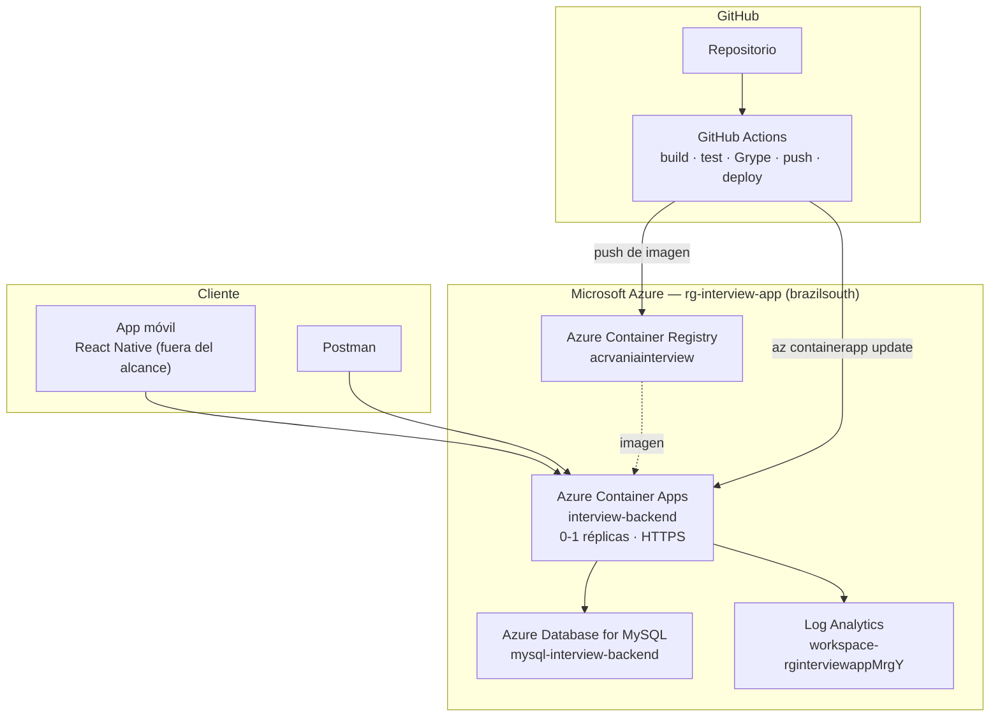

# Interview AI — Backend (Spring Boot en Microsoft Azure)

Backend REST de una aplicación de práctica de entrevistas técnicas, desarrollado con **Spring Boot** y
desplegado en **Microsoft Azure** con un pipeline completo de integración y despliegue continuo.

Trabajo práctico de **Ingeniería de Software Aplicada** — Universidad de Mendoza.

---

## Estado del proyecto

| | |
| :--- | :--- |
| **Versión desplegada** | `interview-backend:v1.1.0` |
| **URL pública** | https://interview-backend.happybay-cc24db11.brazilsouth.azurecontainerapps.io |
| **Pipeline** | ✅ en verde — [ver ejecuciones](https://github.com/vaninafuentes/Interview-backend_prats/actions) |
| **Requisitos verificados** | 38 de 42 completados, 0 sin implementar ([auditoría completa](docs/auditoria-final.md)) |

---

## Tecnologías

| Componente | Tecnología | Versión |
| :--- | :--- | :--- |
| Lenguaje | Java | 21 (LTS) |
| Framework | Spring Boot | 3.5.16 |
| Seguridad | Spring Security + JWT (HS256) | jjwt 0.12.6 |
| Persistencia | Spring Data JPA + Hibernate | 6.6.53 |
| Base de datos | MySQL | 8.0.46 (Azure) / 8.4 (local) |
| Pool de conexiones | HikariCP | incluido en Spring Boot |
| Observabilidad | Spring Boot Actuator + Micrometer | — |
| Build | Gradle (Kotlin DSL) | 9.4.1 |
| Contenedor | Docker multietapa + distroless | — |
| Registro de imágenes | Azure Container Registry | Basic |
| Despliegue | Azure Container Apps | Consumption |
| CI/CD | GitHub Actions | — |
| Seguridad del código | Grype (CVE) + CodeQL (SAST) | — |

---

## Arquitectura



📄 Detalle completo en **[docs/arquitectura.md](docs/arquitectura.md)**

---

## Ejecución local

### Requisitos

- Docker Desktop
- (Opcional) JDK 21 y Git, para ejecutar sin contenedores

### Con Docker Compose (recomendado)

```bash
# Levantar el backend y su base de datos
docker compose up -d

# Ver los logs del backend
docker compose logs -f backend

# Verificar que responde
curl http://localhost:8080/actuator/health      # → {"status":"UP"}

# Detener (conserva los datos)
docker compose stop

# Detener y eliminar los contenedores (el volumen de MySQL se conserva)
docker compose down
```

### Sin Docker

```bash
# Necesita un MySQL accesible; por defecto busca localhost:3307
./gradlew bootRun
```

### Probar el flujo de autenticación

```bash
# 1. Registrar un usuario
curl -X POST http://localhost:8080/api/auth/register \
  -H "Content-Type: application/json" \
  -d '{"name":"Test","email":"test@ejemplo.com","password":"secreto123"}'

# 2. Iniciar sesión y guardar el token
TOKEN=$(curl -s -X POST http://localhost:8080/api/auth/login \
  -H "Content-Type: application/json" \
  -d '{"email":"test@ejemplo.com","password":"secreto123"}' | jq -r .token)

# 3. Consultar un endpoint protegido
curl -H "Authorization: Bearer $TOKEN" http://localhost:8080/api/auth/me
```

---

## Endpoints

| Método | Ruta | Autenticación | Descripción |
| :--- | :--- | :---: | :--- |
| `POST` | `/api/auth/register` | Público | Registra un usuario y devuelve un JWT |
| `POST` | `/api/auth/login` | Público | Autentica y devuelve un JWT |
| `GET` | `/api/auth/me` | 🔒 JWT | Datos del usuario autenticado |
| `GET` | `/api/questions` | 🔒 JWT | Lista las preguntas disponibles |
| `GET` | `/api/questions/{id}` | 🔒 JWT | Una pregunta por id |
| `POST` | `/api/interview/generate` | 🔒 JWT | Genera preguntas con IA |
| `POST` | `/api/interview/evaluate` | 🔒 JWT | Evalúa una respuesta |
| `POST` | `/api/interview/hint` | 🔒 JWT | Devuelve una pista |
| `GET` | `/api/interview/history` | 🔒 JWT | Historial de sesiones |
| `GET` | `/api/interview/stats` | 🔒 JWT | Estadísticas de práctica |
| `GET` | `/actuator/health` | Público | Estado (solo el nivel superior) |
| `GET` | `/actuator/health` | 🔒 JWT | Estado con detalle de componentes |
| `GET` | `/actuator/info` | Público | Versión y fecha de build |
| `GET` | `/actuator/metrics` | 🔒 JWT | Métricas de la aplicación |

---

## Variables de entorno

Todas tienen valor por defecto para desarrollo. En producción se inyectan desde los secretos del
Container App. **Ninguna credencial está en el código.**

| Variable | Descripción |
| :--- | :--- |
| `PORT` | Puerto del servidor (8080) |
| `SPRING_DATASOURCE_URL` | URL JDBC de conexión |
| `SPRING_DATASOURCE_USERNAME` | Usuario de la base |
| `SPRING_DATASOURCE_PASSWORD` | Contraseña de la base 🔒 |
| `SPRING_JPA_HIBERNATE_DDL_AUTO` | Estrategia de esquema (`update`) |
| `SPRING_JPA_SHOW_SQL` | Mostrar SQL en consola (`false` en producción) |
| `HIKARI_MAX_POOL_SIZE` | Conexiones máximas del pool (10) |
| `JWT_SECRET` | Clave de firma de los tokens 🔒 |
| `JWT_EXPIRATION_MS` | Vigencia del token (7 días) |
| `GROQ_API_KEY` | Clave de la API de IA 🔒 (opcional) |

Ver **[.env.example](.env.example)** para la plantilla completa.

---

## Flujo de trabajo (CI/CD)

```
Push a main  ──────────────►  Compila · Testea · Docker build · Grype · Publica en ACR
                                                                          (NO despliega)

Push de tag vX.Y.Z  ───────►  Lo mismo + despliega en Azure Container Apps
                                                                          y verifica el health check

Run workflow  ─────────────►  Igual, pero eligiendo si desplegar y qué versión (permite revertir)
```

**Versionado:** cada imagen se publica con la etiqueta del SHA corto del commit (`:6aec073`) y, si
corresponde a una etiqueta del repositorio, también con la versión semántica (`:v1.1.0`). El despliegue
siempre usa una etiqueta explícita, nunca `latest`.

📄 Detalle completo en **[docs/ci-cd.md](docs/ci-cd.md)**

---

## Seguridad

| Análisis | Herramienta | Qué protege |
| :--- | :--- | :--- |
| Dependencias e imagen (CVE/CVSS) | **Grype** | Bibliotecas de terceros y sistema operativo base |
| Código propio (SAST) | **CodeQL** | Patrones vulnerables en el código que escribimos |

**Resultado de la remediación:** 186 → **115** hallazgos (−38 %), críticas **10 → 3**. Las 3 restantes no
tienen corrección publicada y están justificadas en la documentación.

Otras medidas: imagen distroless con usuario `nonroot`, sin secretos en el repositorio, JWT en todos los
endpoints salvo autenticación y salud, y detalles del health restringidos por rol.

📄 Detalle completo en **[docs/seguridad.md](docs/seguridad.md)**

---

## Monitoreo

Tres capas complementarias: **Actuator/Micrometer** (métricas de la aplicación y del pool de conexiones),
**Azure Monitor** (peticiones, réplicas, reinicios y métricas de JVM) y **Log Analytics** (logs
consultables con KQL).

📄 Detalle completo en **[docs/monitoreo.md](docs/monitoreo.md)**

---

## Documentación

| Documento | Contenido |
| :--- | :--- |
| [docs/arquitectura.md](docs/arquitectura.md) | Componentes, flujo de una petición, modelo de datos, endpoints |
| [docs/docker.md](docs/docker.md) | Dockerfile multietapa, imagen distroless, Docker Compose, comandos |
| [docs/ci-cd.md](docs/ci-cd.md) | Pipeline, versionado, casos de despliegue, resolución de errores |
| [docs/azure.md](docs/azure.md) | Infraestructura, costos y runbook de administración |
| [docs/seguridad.md](docs/seguridad.md) | CVEs, remediación, Grype vs. Trivy vs. Snyk, CodeQL |
| [docs/monitoreo.md](docs/monitoreo.md) | Observabilidad, métricas, consultas KQL, 12 factores |
| [docs/auditoria-final.md](docs/auditoria-final.md) | Verificación de los 42 requisitos con evidencia |
| [docs/guia-parcial.md](docs/guia-parcial.md) | Guía de defensa: 50 preguntas respondidas y simulacro |

---

## Herramientas de operación

```bash
# Panel de administración interactivo
bash scripts/admin.sh

# O directamente una operación
bash scripts/admin.sh estado       # estado general del sistema
bash scripts/admin.sh versiones    # imágenes publicadas en el ACR
bash scripts/admin.sh logs         # logs de la aplicación
bash scripts/admin.sh encender     # encender la base de datos
```

---

## Decisiones de diseño destacadas

1. **La construcción de imágenes es exclusiva del pipeline.** Ningún script local construye ni etiqueta
   imágenes: todo lo que se despliega pasó por los tests y por Grype. Esto corrige el problema del proyecto
   de referencia, donde el script manual y el CI podían desplegar imágenes distintas.
2. **Despliegue desacoplado de la publicación.** Se puede construir y publicar una versión sin liberarla, y
   se puede liberar por etiqueta o manualmente.
3. **El pipeline verifica que la aplicación responda.** Un despliegue no se declara exitoso hasta que el
   endpoint de salud devuelve HTTP 200.
4. **La base de datos se detiene entre sesiones de trabajo** para no consumir crédito; el backend escala a
   cero réplicas cuando no hay tráfico.
5. **El frontend móvil queda fuera del alcance del despliegue**: lo que se despliega es el backend, y la
   aplicación es un cliente que no requería modificaciones.
