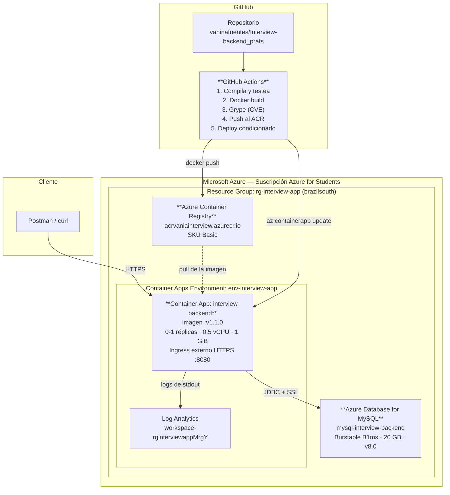
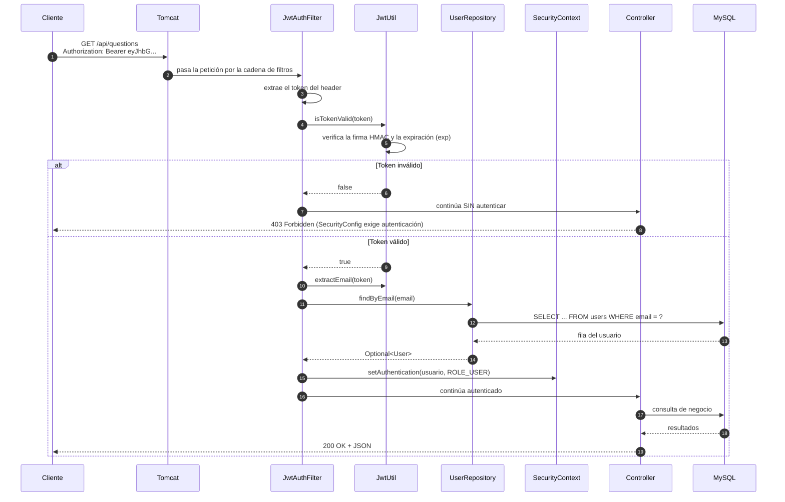
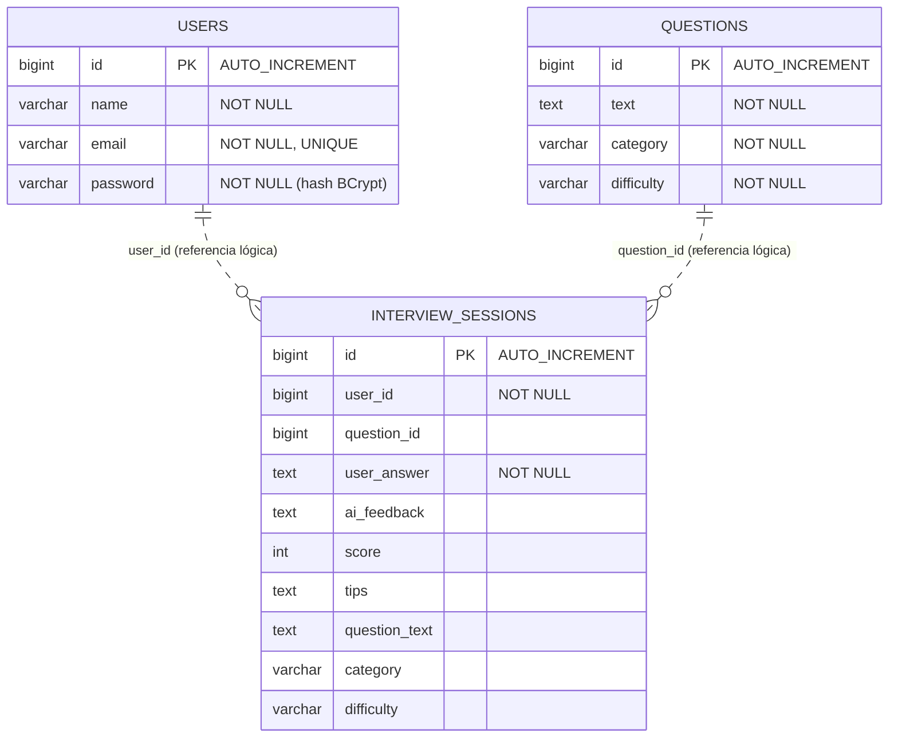

# ARQUITECTURA DEL SISTEMA

**Proyecto:** Interview AI Backend (Spring Boot)  
**Versión desplegada:** `v1.1.0`

---

## 1. VISIÓN GENERAL

El sistema es una **API REST** que sirve a una aplicación de práctica de entrevistas técnicas. El backend
concentra toda la lógica de negocio, la persistencia y la autenticación; el cliente móvil consume la API
mediante HTTPS con tokens JWT.

El backend se empaqueta en una **imagen Docker** y se despliega en **Azure Container Apps**, con la base de
datos gestionada en **Azure Database for MySQL** y las imágenes almacenadas en **Azure Container Registry**.

---

## 2. DIAGRAMA DE DESPLIEGUE



**Flujo de una petición:**

```
Cliente
  │  HTTPS 443
  ▼
Azure Container Apps (terminación TLS + ingress)
  │  HTTP 8080
  ▼
Spring Boot (contenedor distroless, usuario nonroot)
  │
  ├─ JwtAuthFilter     → valida el token y carga el usuario
  ├─ Controller        → recibe y valida el DTO
  ├─ Service           → lógica de negocio
  ├─ Repository (JPA)  → acceso a datos
  │
  ▼
HikariCP (pool de 10 conexiones)
  │  JDBC + SSL (sslMode=REQUIRED)
  ▼
Azure Database for MySQL → interviewai_db
```

---

## 3. ESTRUCTURA DEL BACKEND

```
src/main/java/com/example/interviewback/
│
├── InterviewBackApplication.java     Punto de entrada
│
├── config/                           Configuración transversal
│   ├── SecurityConfig.java           Cadena de filtros, BCrypt, UserDetailsService
│   ├── CorsConfig.java               Orígenes permitidos (necesario para el cliente web)
│   ├── AppConfig.java                Beans generales
│   ├── DataSeeder.java               Siembra las preguntas iniciales
│   └── GlobalExceptionHandler.java   Manejo centralizado de errores
│
├── security/                         Autenticación
│   ├── JwtUtil.java                  Genera y valida tokens (HMAC-SHA)
│   └── JwtAuthFilter.java            Filtro que autentica cada petición
│
├── controller/                       Capa de entrada HTTP
│   ├── AuthController.java           /api/auth/**
│   ├── QuestionController.java       /api/questions/**
│   └── InterviewController.java      /api/interview/**
│
├── service/                          Lógica de negocio
│   ├── AuthService.java              Registro y login
│   ├── QuestionService.java          Consulta de preguntas
│   ├── InterviewService.java         Sesiones, historial y estadísticas
│   └── GroqService.java              Integración con la API de IA (opcional)
│
├── repository/                       Acceso a datos (Spring Data JPA)
│   ├── UserRepository.java
│   ├── QuestionRepository.java
│   └── InterviewSessionRepository.java
│
├── model/                            Entidades JPA
│   ├── User.java
│   ├── Question.java
│   └── InterviewSession.java
│
└── dto/                              Objetos de transferencia
    ├── RegisterRequest.java          Con validaciones (@NotBlank, @Email, @Size)
    ├── LoginRequest.java
    ├── AuthResponse.java
    └── ...                           DTOs de entrevistas y estadísticas
```

**Patrón de capas:** cada petición atraviesa *controller → service → repository → base de datos*. Los
**DTO** separan lo que entra y sale por HTTP de las **entidades** que se persisten, de modo que cambiar el
modelo de datos no rompa el contrato de la API.

---

## 4. FLUJO DE UNA PETICIÓN AUTENTICADA



**Puntos clave para explicar:**

- El token **no se consulta en la base de datos en cada petición** para validar la firma: se verifica
  criptográficamente con la clave secreta. La consulta al repositorio es para **cargar el usuario completo**.
- La sesión es **STATELESS**: no se guarda nada en el servidor entre peticiones. Esa es la razón por la que
  el backend puede escalar horizontalmente sin compartir sesiones.
- El filtro **no rechaza** la petición cuando el token falta o es inválido: simplemente la deja pasar sin
  autenticar, y es `SecurityConfig` quien decide (403) según las reglas de autorización.

---

## 5. MODELO DE DATOS



**Decisión de diseño (y crítica honesta):** las sesiones guardan `user_id` y `question_id` como **números
planos**, no como relaciones `@ManyToOne`. Ventaja: simplicidad y consultas sin *joins* implícitos.
Desventaja: **no hay integridad referencial a nivel de base de datos** (MySQL no impide borrar un usuario
que tiene sesiones). Se documenta como limitación conocida; en un sistema en producción correspondería
agregar claves foráneas o un `@ManyToOne` con la política de borrado definida.

El esquema lo crea **Hibernate** a partir de las entidades (`ddl-auto=update`). Es adecuado para este
proyecto; en un sistema en producción correspondería usar **migraciones versionadas** (Flyway o Liquibase)
con `ddl-auto=validate` para que el esquema evolucione de forma controlada y auditable.

---

## 6. SEGURIDAD DE LA API

```
PÚBLICO                          PROTEGIDO (JWT obligatorio)
────────────────────────         ─────────────────────────────────────
POST /api/auth/register          GET  /api/auth/me
POST /api/auth/login             GET  /api/questions
GET  /actuator/health            GET  /api/questions/{id}
GET  /actuator/health/**         POST /api/interview/generate
GET  /actuator/info              POST /api/interview/evaluate
                                 POST /api/interview/hint
                                 GET  /api/interview/history
                                 GET  /api/interview/stats
                                 GET  /actuator/metrics
```

**Configuración:** sin sesiones HTTP (`STATELESS`), sin CSRF (es una API REST, no hay formularios), CORS
restringido configurado en `CorsConfig`, contraseñas con BCrypt (factor 10) y opciones (`OPTIONS`) públicas
para que funcione el *preflight* de CORS desde el navegador.

📄 Detalle completo en **[seguridad.md](seguridad.md)**

---

## 7. DECISIONES ARQUITECTÓNICAS Y SU JUSTIFICACIÓN

| Decisión | Por qué | Alternativa descartada |
| :--- | :--- | :--- |
| **Monolito modular en capas** | El dominio es pequeño; la separación por capas ya da orden y testeabilidad | Microservicios: complejidad desproporcionada para el tamaño del sistema |
| **JWT sin estado** | Permite escalar horizontalmente sin sesiones compartidas; encaja con contenedores efímeros | Sesiones en memoria: se perderían al reiniciar el contenedor |
| **MySQL gestionado en Azure** | Servicio administrado: copias de seguridad, parches y alta disponibilidad sin operación | MySQL en contenedor: más barato pero sin persistencia gestionada |
| **Imagen distroless** | Menor superficie de ataque y menos vulnerabilidades (medido con Grype) | Imagen completa: más de 400 CVEs de sistema operativo |
| **Container Apps** | Escala a cero, HTTPS y dominio incluidos, sin administrar Kubernetes | AKS: costo y complejidad muy superiores; App Service: sin escalado a cero |
| **Construcción solo en el pipeline** | Garantiza que toda imagen desplegada pasó por tests y escaneo | Script local: permitía desplegar imágenes distintas a las del CI |
| **DTO separados de las entidades** | El contrato de la API no queda acoplado al modelo de datos | Exponer entidades: filtraría el hash de la contraseña |
