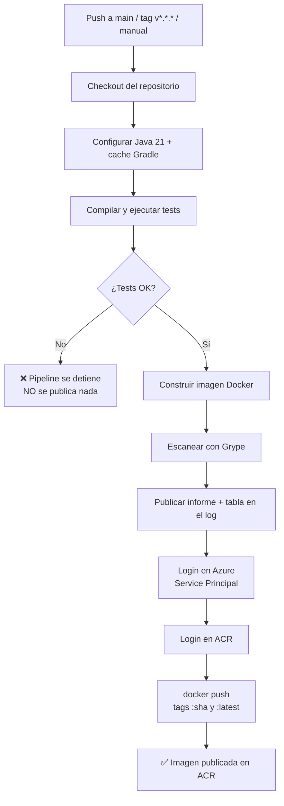

# INTEGRACIÓN CONTINUA Y DESPLIEGUE CONTINUO (CI/CD)

**Proyecto:** Interview AI Backend (Spring Boot)  
**Repositorio:** https://github.com/vaninafuentes/Interview-backend_prats  
**Workflow:** `.github/workflows/ci.yml`  
**Última verificación:** 11 de Octubre de 2026 — pipeline ejecutado con éxito (15/15 pasos)

---

## 1. CONCEPTOS

| Concepto | Definición aplicada a este proyecto |
| :--- | :--- |
| **Integración Continua (CI)** | Cada push a `main` compila el código, **ejecuta los tests**, construye la imagen Docker, la escanea con Grype y la publica en el ACR de forma automática. Nadie construye imágenes a mano. |
| **Despliegue Continuo (CD)** | Llevar esa imagen a Azure Container Apps. **En este proyecto está desacoplado y condicionado a propósito** (ver sección 6): una cosa es publicar una imagen y otra muy distinta liberarla a producción. |
| **Pipeline** | La secuencia de pasos automáticos que corre GitHub Actions. Cada ejecución se llama *run*. |
| **Runner** | La máquina virtual (Ubuntu) donde GitHub ejecuta el pipeline. Es descartable: se crea y se destruye en cada ejecución. |
| **Job** | Un conjunto de pasos que corre en un runner. Este pipeline tiene un job (`build-scan-push`). |
| **Step** | Cada tarea individual dentro del job. |
| **Artifact** | Archivo que el pipeline produce y queda disponible para descargar (informes de tests, informe de Grype). |

---

## 2. DIAGRAMA DEL PIPELINE



**Decisión de diseño:** si los tests fallan, el pipeline **se detiene antes de construir nada**. Nunca se publica una imagen rota. Se comprueba en la primera ejecución (falló por el permiso de `gradlew` y no llegó a publicar).

---

## 3. LOS 13 PASOS, EXPLICADOS

| # | Paso | Qué hace y por qué |
| :---: | :--- | :--- |
| 1 | Checkout del repositorio | Descarga el código del commit que disparó el pipeline en el runner. |
| 2 | Configurar Java 21 (Temurin) | Instala el JDK y **cachea Gradle**: las ejecuciones siguientes tardan mucho menos. |
| 3 | Compilar y ejecutar los tests | `./gradlew build`. Corre contra un **MySQL efímero** (ver abajo). **Los tests NO se desactivan.** |
| 4 | Publicar el resultado de los tests | Sube el reporte HTML como artefacto, incluso si el paso anterior falló (`if: always()`). |
| 5 | Calcular las etiquetas de la imagen | Genera `:sha-corto` y, si el disparador es un tag git, también `:vX.Y.Z`. |
| 6 | Construir la imagen Docker | `docker build` con los argumentos OCI (`BUILD_DATE`, `VCS_REF`, `IMAGE_TAG`) que usa el Dockerfile. |
| 7 | Instalar Grype | Descarga el binario oficial de Anchore en el runner. |
| 8 | Escanear la imagen con Grype | Imprime la tabla completa en el log, genera JSON y un **resumen por severidad en el panel de la ejecución**. |
| 9 | Publicar el informe de vulnerabilidades | Sube `grype-report.json` y `.txt` como artefactos (retención 30 días). |
| 10 | Login en Azure (Service Principal) | `azure/login@v3` lee el JSON del Service Principal desde el secret `AZURE_CREDENTIALS`. |
| 11 | Login en ACR | `az acr login` **reutiliza la sesión del SP** (no usa el usuario admin del registro). |
| 12 | Publicar la imagen en el ACR | `docker push --all-tags` y escribe en el resumen de la ejecución qué etiquetas quedaron publicadas. |
| 13 | Cerrar sesión en Azure | `az logout` con `if: always()` para no dejar la sesión abierta. |

### MySQL efímero (service container)

El job declara un servicio `mysql:8` que **existe solo durante esa ejecución del pipeline**:

```yaml
services:
  mysql:
    image: mysql:8
    env:
      MYSQL_ROOT_PASSWORD: root
      MYSQL_DATABASE: interviewai_db
    ports:
      - 3306:3306
    options: >-
      --health-cmd="mysqladmin ping -h 127.0.0.1 -uroot -proot"
      ...
```

**Por qué:** el test `contextLoads` es un `@SpringBootTest` que levanta el contexto completo, incluyendo la conexión a la base. Sin este servicio, el test falla por falta de base de datos — y la tentación es desactivarlo, con lo cual el pipeline queda verde pero no prueba nada. Con el servicio, los tests corren **de verdad**. Las credenciales (`root`/`root`) son descartables porque el contenedor se destruye al terminar.

---

## 4. ESTRATEGIA DE VERSIONADO DE IMÁGENES

Esta es la parte que en el proyecto de referencia (Go) estaba **inconsistente**: el script manual usaba una etiqueta configurada en `.env` y el pipeline otra. Acá la regla es única:

| Etiqueta | Cuándo se genera | Para qué sirve |
| :--- | :--- | :--- |
| `:<sha-corto>` | **Siempre** (por ejemplo `6aec073`) | Trazabilidad total: dado un contenedor corriendo, se sabe **exactamente** qué commit lo generó. |
| `:vX.Y.Z` | Solo si el push es de un tag git `v*.*.*` | Versión semántica legible, alineada con la etiqueta del repositorio. |
| `:latest` | Siempre | Alias de comodidad para `docker pull`. **El despliegue NUNCA lo usa.** |

**Regla de oro:** el despliegue siempre referencia una etiqueta explícita (`v1.0.1` o `6aec073`), nunca `latest`. Así se sabe qué está corriendo y se puede volver atrás con precisión.

---

## 5. SECRETS Y VARIABLES NECESARIOS EN GITHUB

Se configuran en: **Settings → Secrets and variables → Actions**

| Nombre | Tipo | Para qué |
| :--- | :--- | :--- |
| `AZURE_CREDENTIALS` | 🔒 Secret | JSON con `clientId`, `clientSecret`, `subscriptionId`, `tenantId` del Service Principal. Es **lo único verdaderamente sensible**. |
| `ACR_REGISTRY` | Secret | `acrvaniainterview.azurecr.io` |
| `AZURE_RESOURCE_GROUP` | Secret | `rg-interview-app` (se usa en el despliegue, Fase 11) |

> **Nota conceptual:** los *Secrets* se guardan cifrados y GitHub los enmascara como `***` en los logs.
> Las *Variables* son texto plano para configuración no sensible. En este proyecto se usan Secrets para
> ambos casos, siguiendo el mismo criterio que el proyecto de referencia de la cursada.

**Cómo se usa en el workflow:**

```yaml
env:
  REGISTRY: ${{ secrets.ACR_REGISTRY }}      # se lee en tiempo de ejecución
  IMAGE_NAME: interview-backend

steps:
  - uses: azure/login@v3
    with:
      creds: ${{ secrets.AZURE_CREDENTIALS }}
  - run: az acr login --name "${REGISTRY%%.*}"   # deriva el nombre desde el FQDN
```

---

## 6. CASOS DE USO (preparación para el parcial)

| Caso | Cómo se logra | Estado |
| :--- | :--- | :---: |
| **A** — Construir y publicar una imagen **sin** desplegar | Un push a `main` dispara el pipeline, que construye, escanea y publica. El despliegue es un job separado que **no existe en el pipeline de CI**. | ✅ **Implementado y funcionando** |
| **B** — Construir, publicar **y** desplegar | Requiere el job de despliegue condicionado en Azure Container Apps. | ⏳ Fase 11 |
| **C** — Ejecutar manualmente eligiendo si desplegar | `workflow_dispatch` con un input `deploy` (booleano) que condiciona el job de despliegue. | ⏳ Fase 11 |

---

## 7. CÓMO LEER LOS LOGS DESDE GITHUB (paso a paso)

1. Ir a **https://github.com/vaninafuentes/Interview-backend_prats/actions**
2. En la lista de la izquierda se ven los workflows (`CI - Build, Scan y Publicación en ACR`).
   En el centro, cada fila es una **ejecución** con el commit, la rama y el estado (✅ / ❌).
3. Hacer clic sobre la ejecución que se quiere inspeccionar.
4. Se abre el resumen con:
   - **Jobs en el panel izquierdo** → clic en `Compilar, testear, escanear y publicar`.
   - **El log completo a la derecha**, con cada paso desplegable.
   - **Summary**: incluye el resumen de vulnerabilidades por severidad y las etiquetas publicadas.
5. Para ver el error de un paso que falló: desplegar ese paso (los fallidos se abren solos y se marcan en rojo).
6. **Artifacts** (al final del resumen): descargar `informe-grype` o `resultado-tests`.
7. Para volver a ejecutar: botón **Re-run all jobs** (arriba a la derecha) → *Re-run failed jobs* si solo falló uno.
8. Para disparar manualmente: pestaña **Actions** → workflow en la izquierda → **Run workflow**
   (desplegable) → elegir la rama → **Run workflow**.

---

## 8. ERRORES ENCONTRADOS Y RESUELTOS

### Error 1 — `./gradlew: Permission denied` (primera ejecución)

**Síntoma:** la primera ejecución falló en el paso de compilación y el pipeline se detuvo sin publicar nada.

**Causa:** en Windows, git no registra el bit de ejecución (`core.fileMode=false`). El archivo `gradlew`
quedó guardado en el repositorio con modo `100644` (no ejecutable), y en el runner Linux `./gradlew`
no se puede ejecutar.

**Diagnóstico:**
```bash
git ls-files -s gradlew
# 100644 ... gradlew   <-- incorrecto: no es ejecutable
```

**Solución aplicada:**
```bash
git update-index --chmod=+x gradlew
git commit -m "fix(ci): marcar gradlew como ejecutable en git"
```
Verificación posterior: `git ls-files -s gradlew` → `100755`.

**Por qué así y no con un `chmod` en el workflow:** corregir el modo en el repositorio hace que el
permiso quede registrado para siempre y para cualquiera que clone el proyecto. Un `chmod` en el
workflow solo taparía el síntoma en el pipeline y el problema seguiría existiendo para quien ejecute
`./gradlew` en Linux desde un clon nuevo.

**Nota:** el mismo problema ya estaba resuelto dentro del Dockerfile con `RUN chmod +x gradlew`, lo
que confirma que la causa era el metadato de git y no el archivo.

---

## 9. PENDIENTE (Fase 11)

- Job de despliegue a Azure Container Apps, condicionado.
- Control de despliegue por rama, por tag git y por input manual (`workflow_dispatch`).
- Botón de despliegue explícito desde la interfaz de GitHub.
