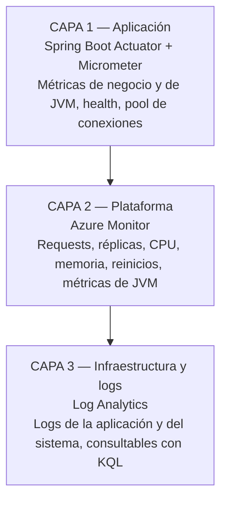

# MONITOREO Y OBSERVABILIDAD

**Proyecto:** Interview AI Backend (Spring Boot)  
**Última verificación:** 11 de Octubre de 2026 — endpoints y métricas comprobados en local y en Azure

---

## 1. LAS PREGUNTAS QUE TENEMOS QUE PODER RESPONDER

| Pregunta | Cómo se responde | Dónde |
| :--- | :--- | :--- |
| ¿Cómo sabemos si Spring Boot está funcionando? | `GET /actuator/health` → `{"status":"UP"}` | Actuator |
| ¿Cómo sabemos si se conecta a la base de datos? | `GET /actuator/health` **con token** → `components.db.status = UP` | Actuator |
| ¿Cómo sabemos si una petición llegó al servidor? | Métrica `http.server.requests` con `COUNT` por endpoint, y la métrica `Requests` en Azure Monitor | Actuator + Azure Monitor |
| ¿Cómo sabemos si el login funcionó? | Métricas del endpoint `/api/auth/login`: cantidad de llamadas y tiempos | Actuator (Micrometer) |
| ¿Cómo medimos cuánto tardó una petición? | `http.server.requests` → `TOTAL_TIME` y `MAX`; métrica `Requests` en Azure Monitor | Actuator + Azure Monitor |
| ¿Cómo vemos un error? | Logs de la aplicación: `Log_stream` en vivo o consulta a Log Analytics | Log Analytics |
| ¿Cómo revisamos los logs desde Azure? | **Monitoring → Log stream** (en vivo) o **Monitoring → Logs** (histórico, KQL) | Azure |
| ¿Cómo sabemos si la aplicación se está reiniciando? | Métrica **`RestartCount`** en Azure Monitor | Azure Monitor |
| ¿Cómo identificamos si fallaron variables de entorno? | El contenedor arranca y muere; los logs muestran el `Caused by` exacto (por ejemplo, `Connection refused` si falta la URL de la base) | Log Analytics |

> **Caso real ya vivido:** la aplicación devolvía HTTP 503. Los logs de Log Analytics mostraron la cadena
> `Connection refused → Communications link failure → JPA EntityManagerFactory → Unable to start embedded Tomcat`.
> Eso permitió diagnosticar que faltaban las variables de entorno de la base **sin adivinar**. Los logs no
> sirven solo para ver errores: sirven para encontrar la causa.

---

## 2. LAS TRES CAPAS DE OBSERVABILIDAD



Cada capa responde preguntas distintas. **Ninguna alcanza sola:** Actuator sabe si la base responde, pero no
si el contenedor está reiniciando; Azure Monitor sabe si el contenedor está reiniciando, pero no si el login
está fallando más que ayer.

---

## 3. CAPA 1 — SPRING BOOT ACTUATOR

### Endpoints expuestos

| Endpoint | ¿Público? | Qué devuelve |
| :--- | :---: | :--- |
| `/actuator/health` | ✅ Sin token | `{"status":"UP"}` — **solo el estado** |
| `/actuator/health` | 🔒 Con token | Detalle completo: base de datos, disco, sondas |
| `/actuator/health/liveness` | ✅ Sin token | Sonda de vida (la usa Azure) |
| `/actuator/health/readiness` | ✅ Sin token | Sonda de preparación (la usa Azure) |
| `/actuator/info` | ✅ Sin token | Versión y fecha de build |
| `/actuator/metrics` | 🔒 Con token | Todas las métricas disponibles |
| `/actuator/metrics/<nombre>` | 🔒 Con token | Una métrica en particular, con etiquetas |

### 🔒 Decisión de seguridad aplicada

**Antes:** `management.endpoint.health.show-details=always` exponía **públicamente** el motor de base de
datos, el espacio en disco del contenedor y la estructura interna de componentes. Es información que le sirve
a un atacante para preparar un ataque y no le aporta nada a un usuario anónimo.

**Ahora:** `show-details=when-authorized` con `roles=USER`.

```properties
management.endpoint.health.show-details=when-authorized
management.endpoint.health.show-components=when-authorized
management.endpoint.health.roles=USER
```

**Comportamiento verificado** (11/10/2026):

| Petición | Respuesta |
| :--- | :--- |
| `GET /actuator/health` sin token | `{"status":"UP","groups":["liveness","readiness"]}` |
| `GET /actuator/health` con token válido | `{"status":"UP","components":{"db":{"status":"UP","details":{"database":"MySQL",…}}}}` |
| `GET /actuator/metrics` sin token | **HTTP 403** |

**Por qué el endpoint sigue siendo público a propósito:** lo necesitan las **sondas de Azure Container Apps**
para saber si el contenedor está vivo, y lo necesita el **pipeline de despliegue** para verificar que la
versión recién desplegada realmente responde. Exponer el estado (`UP`/`DOWN`) no es un riesgo; exponer los
detalles internos sí.

### Corrección asociada en el filtro JWT

Para que `roles=USER` funcionara había que resolver una inconsistencia real: `JwtAuthFilter` creaba la
autenticación con `Collections.emptyList()`, es decir **sin ninguna autoridad**, mientras que el
`UserDetailsService` de `SecurityConfig` otorgaba `ROLE_USER` al autenticarse por login. El mismo usuario
tenía permisos distintos según cómo se hubiera autenticado. Se unificó asignando `ROLE_USER` en el filtro.

---

## 4. MÉTRICAS DE LA APLICACIÓN (Micrometer)

### Tiempos de respuesta HTTP

```bash
TOKEN=$(curl -s -X POST https://<fqdn>/api/auth/login \
  -H "Content-Type: application/json" \
  -d '{"email":"...","password":"..."}' | jq -r .token)

curl -s -H "Authorization: Bearer $TOKEN" \
  "https://<fqdn>/actuator/metrics/http.server.requests"
```

Devuelve `COUNT` (cantidad de peticiones), `TOTAL_TIME` (tiempo acumulado en segundos) y `MAX` (la más lenta),
con etiquetas para filtrar por endpoint, método y código de respuesta:

```bash
curl -s -H "Authorization: Bearer $TOKEN" \
  "https://<fqdn>/actuator/metrics/http.server.requests?tag=uri:/api/questions"
```

**Evidencia real medida en local:**

| Endpoint | Peticiones | Tiempo total | Más lenta |
| :--- | :---: | :---: | :---: |
| `/api/questions` | 5 | 0,089 s | 0,023 s |
| Global (todos los endpoints) | 12 | 1,034 s | 0,489 s |

### Pool de conexiones HikariCP

| Métrica | Qué mide |
| :--- | :--- |
| `hikaricp.connections.max` | Máximo del pool → **verificado: 10** |
| `hikaricp.connections.active` | Conexiones en uso en este momento |
| `hikaricp.connections.idle` | Conexiones disponibles |
| `hikaricp.connections.pending` | Peticiones esperando una conexión |
| `hikaricp.connections.timeout` | Veces que se agotó el tiempo de espera |
| `hikaricp.connections.acquire` | Tiempo que tarda en entregar una conexión |

**Cómo se lee esto en la defensa:** si `pending` sube o `timeout` es mayor que cero, el pool se quedó corto y
hay que subir `HIKARI_MAX_POOL_SIZE`. Si `active` está siempre en el máximo pero `pending` es cero, el pool
está bien dimensionado. El nombre del pool es `InterviewHikariPool` (aparece como etiqueta).

### Métricas de la JVM

Disponibles a través de Actuator (`jvm.memory.used`, `jvm.gc.pause`, `process.cpu.usage`) y **también nativas
en Azure Monitor** (ver capa 2).

### Verificación completa

```bash
curl -s -H "Authorization: Bearer $TOKEN" "https://<fqdn>/actuator/metrics" | jq -r '.names[]'
# 98 métricas disponibles en la aplicación
```

---

## 5. CAPA 2 — AZURE MONITOR

Azure recolecta métricas del contenedor de forma automática, sin instalar nada. Se ven en:

**Portal → Container Apps → `interview-backend` → Monitoring → Metrics**

### Métricas de plataforma útiles

| Métrica | Para qué sirve |
| :--- | :--- |
| **Requests** | Cantidad de peticiones recibidas. Responde "¿está llegando tráfico?" |
| **Replicas** | Cuántas instancias están corriendo. En este proyecto va de **0 a 1** |
| **RestartCount** | **Reinicios del contenedor.** Es la respuesta a "¿cómo sé si la aplicación se está reiniciando?" |
| **UsageNanoCores** | Consumo de CPU |
| **WorkingSetBytes** | Memoria en uso |
| **TxBytes / RxBytes** | Tráfico de red de entrada y salida |

### Métricas de JVM (específicas para aplicaciones Java)

Azure las expone automáticamente:

| Métrica | Para qué sirve |
| :--- | :--- |
| `JvmMemoryUsed` / `JvmMemoryLimit` | Memoria de heap usada contra el límite disponible |
| `JvmGcCount` | Cantidad de recolecciones de basura |
| `JvmMemoryCommitted` | Memoria reservada |

**Por qué importa:** con `-XX:MaxRAMPercentage=75.0` (configurado en el Dockerfile), el heap se ajusta al
límite del contenedor. Si `JvmMemoryUsed` se acerca a `JvmMemoryLimit` de forma sostenida, conviene subir la
memoria del Container App o bajar `MaxRAMPercentage`.

### Por terminal

```bash
APP_ID=$(az containerapp show -n interview-backend -g rg-interview-app --query id -o tsv)

az monitor metrics list --resource "$APP_ID" \
  --metric "Requests,Replicas,RestartCount" \
  --interval PT1H --aggregation Total,Average -o table
```

**Evidencia real medida (última hora del 11/10/2026):**

| Métrica | Valor |
| :--- | :--- |
| `Requests` (Total) | **2** |
| `Replicas` (Average) | **0,25** ← la aplicación estuvo la mayor parte del tiempo en cero |

El valor de réplicas confirma que el **escalado a cero funciona**: no se paga cómputo cuando nadie usa la
aplicación.

---

## 6. CAPA 3 — LOG ANALYTICS

Todos los `stdout` del contenedor llegan automáticamente al workspace `workspace-rginterviewappMrgY`
(el Container Apps Environment está conectado a él).

**Portal → Container Apps → `interview-backend` → Monitoring → Logs** (o desde *Log Analytics workspaces*).

### Esquema real de la tabla

| Columna | Contenido |
| :--- | :--- |
| `TimeGenerated` | Fecha y hora del evento |
| `Log_s` | La línea de log de la aplicación |
| `ContainerAppName_s` | Nombre de la aplicación |
| `RevisionName_s` | **Revisión que generó el log** (permite saber qué versión lo escribió) |
| `ContainerName_s` | Nombre del contenedor |
| `Stream_s` | Flujo (`stdout` / `stderr`) |

### Consultas útiles (KQL)

```kusto
// Últimas líneas de la aplicación
ContainerAppConsoleLogs_CL
| order by TimeGenerated desc
| take 50
| project TimeGenerated, RevisionName_s, Log_s

// Solo errores (muy útil para diagnosticar por qué no arranca)
ContainerAppConsoleLogs_CL
| where Log_s has_any ('ERROR', 'Exception', 'Caused by')
| order by TimeGenerated desc
| take 50
| project TimeGenerated, Log_s

// Arranques de la aplicación: cuándo y con qué revisión
ContainerAppConsoleLogs_CL
| where Log_s has 'Started InterviewBackApplication'
| project TimeGenerated, RevisionName_s, Log_s

// Logs de una revisión concreta
ContainerAppConsoleLogs_CL
| where RevisionName_s == "interview-backend--latest"
| order by TimeGenerated desc
| take 100

// Errores de conexión a la base de datos
ContainerAppConsoleLogs_CL
| where Log_s has_any ('Connection refused', 'Communications link failure', 'JDBCConnectionException')
| order by TimeGenerated desc
| take 20
```

### Por terminal (el CLI requiere `az rest`, ver nota)

```bash
# Obtener el ID del workspace
WS=$(az monitor log-analytics workspace show -g rg-interview-app \
  -n workspace-rginterviewappMrgY --query customerId -o tsv)

# Consultar (el subcomando nativo pide instalar una extensión; az rest lo evita)
echo '{"query":"ContainerAppConsoleLogs_CL | order by TimeGenerated desc | take 20 | project TimeGenerated, Log_s","timespan":"PT12H"}' > /tmp/q.json

az rest --method post \
  --url "https://api.loganalytics.io/v1/workspaces/${WS}/query" \
  --body @/tmp/q.json
```

---

## 7. ¿POR QUÉ NO USAMOS APPLICATION INSIGHTS?

Se evaluó y **se decidió no incorporarlo**. Razones:

1. **Duplicaría lo que ya tenemos.** Application Insights se usa para trazas distribuidas y telemetría de
   aplicación. Acá ya hay métricas con Micrometer/Actuator, métricas de plataforma y de JVM con Azure Monitor,
   y logs centralizados con Log Analytics. Las tres capas ya están cubiertas.
2. **Este proyecto es un monolito**, no un sistema de microservicios: no hay trazas que correlacionar entre
   servicios, que es el valor principal de Application Insights.
3. **Costo y complejidad:** exige agregar el agente de Java a la imagen, un nuevo secreto con la cadena de
   conexión y volumen de ingesta que se factura aparte.
4. **Regla aplicada:** no agregar complejidad solo para mostrar que se conoce una herramienta.

Si en el futuro se pasara a microservicios, sería el momento de incorporarlo.

---

## 8. RELACIÓN CON LOS 12 FACTORES

| Factor | Cómo se aplica | Dónde se ve |
| :--- | :--- | :--- |
| **III. Config** — configuración en el entorno | Ningún valor de configuración está en el código. `application.properties` solo tiene marcadores `${VARIABLE:default}`; los valores reales se inyectan por variables de entorno (local y Azure). Los secretos apuntan a `secretref:` | `application.properties`, `docker-compose.yml`, Container App |
| **V. Build, release, run** — separar construir, liberar y ejecutar | El pipeline **construye** (etapa 1), **publica** una versión inmutable en el ACR con etiqueta del SHA (etapa 2 / *release*) y el despliegue la **ejecuta** (etapa 3 / *run*). Se puede construir y publicar sin liberar (Caso A) y se puede liberar una versión anterior (rollback) | `.github/workflows/ci.yml` |
| **VII. Port binding** — el servicio expone su puerto | Spring Boot se auto-contiene: arranca Tomcat en el puerto 8080 (`server.port=${PORT:8080}`) y expone el puerto por sí mismo, sin servidor externo. Azure publica ese puerto por ingress | `application.properties`, `Dockerfile` (`EXPOSE 8080`) |
| **XI. Logs** — tratar los logs como flujo de eventos | La aplicación **no escribe archivos de log**: escribe a `stdout`/`stderr`, y Azure los captura y los envía a Log Analytics. `spring.jpa.show-sql=false` en producción para no inundar | `Dockerfile`, Container App |

> ⚠️ **Precisión importante para la defensa:** el factor XI (Logs) es **solo una parte** de la
> observabilidad, no toda. Los logs responden *"¿qué pasó?"*. Las métricas responden *"¿cuánto, cuántas
> veces, cuán rápido?"* y las sondas de salud responden *"¿está vivo y listo ahora mismo?"*. Este proyecto
> cubre las tres, y por eso hay tres capas y no solo logs.

---

## 9. HEALTH CHECKS Y EL PIPELINE

El health check no es solo para mirar a mano: **es parte del control de calidad del despliegue**.

```
Deploy a Azure Container Apps
        ↓
Espera hasta 30 intentos (5 minutos)
        ↓
curl https://<fqdn>/actuator/health
        ↓
¿HTTP 200? ──No──> ❌ el pipeline falla y no se declara exitoso
        │
       Sí
        ↓
✅ Pipeline en verde + tabla de evidencia en el Summary
```

**Por qué esto importa:** un `az containerapp update` que responde "OK" solo significa que Azure **aceptó el
comando**, no que la aplicación funcione. Sin la verificación, el pipeline podría estar en verde con el
contenedor muriendo en un bucle de reinicios — exactamente el HTTP 503 que tuvimos al principio del proyecto.

---

## 10. COMANDOS RÁPIDOS

```bash
# Estado general del sistema (aplicación, base, revisiones, health)
bash scripts/admin.sh estado

# Health público (solo el estado)
curl https://<fqdn>/actuator/health

# Health con detalle (requiere token)
TOKEN=$(curl -s -X POST https://<fqdn>/api/auth/login -H "Content-Type: application/json" \
  -d '{"email":"...","password":"..."}' | jq -r .token)
curl -H "Authorization: Bearer $TOKEN" https://<fqdn>/actuator/health

# Métricas de la aplicación
curl -H "Authorization: Bearer $TOKEN" https://<fqdn>/actuator/metrics | jq -r '.names[]'

# Tiempos de respuesta
curl -H "Authorization: Bearer $TOKEN" "https://<fqdn>/actuator/metrics/http.server.requests"

# Métricas de Azure
az monitor metrics list --resource "$(az containerapp show -n interview-backend -g rg-interview-app --query id -o tsv)" \
  --metric "Requests,Replicas,RestartCount" --interval PT1H --aggregation Total,Average -o table
```
